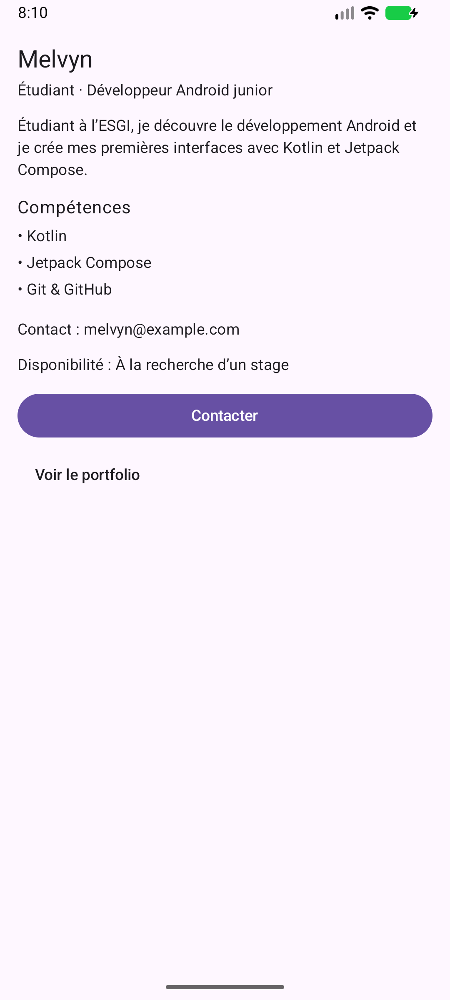

# Profil développeur Compose

Cette application Android présente une fiche de développeur junior inspirée de mon profil étudiant à l’ESGI.\
Elle affiche un nom, un rôle, une description, trois compétences, une disponibilité et un contact fictif.\
Un bouton de contact et une zone de portfolio transmettent des événements de clic via des callbacks.\
Deux previews présentent des profils différents.

## Capture de l’application

Capture réelle de l’application exécutée sur Android :

Les adresses en `example.com` sont fictives. Les clics sont volontairement sans effet, comme l’autorise le sujet.

## Notions utilisées

- Fonctions `@Composable`, paramètres et composants réutilisables.
- `Text`, `Button`, `Surface` et `Column`.
- `Modifier`, `fillMaxWidth`, `padding` et chaînage des modifiers.
- Padding externe et interne.
- Callbacks de type `() -> Unit`.
- Zone `clickable`, `Role.Button`, `semantics` et `contentDescription`.
- `MainActivity`, `setContent`, thème Material, `Scaffold` et `innerPadding`.
- Deux variantes avec `@Preview`.

## Réponses aux questions

1. **Quels composables avez-vous créés ?**\
   `DeveloperProfileScreen`, `ProfileCard`, `ProfileHeader`, `SkillItem`, `SecondaryInformation`, `ProfileAction` et `PortfolioAction`. Le thème `ProfilComposeTheme` les enveloppe ; `AndroidProfilePreview` et `FullStackProfilePreview` permettent de les prévisualiser.

2. **Quel composable représente l’écran principal ?**\
   `DeveloperProfileScreen`. Il utilise un `Scaffold`, applique son `innerPadding` et place la fiche.

3. **Où utilisez-vous un padding externe ?**\
   Dans `DeveloperProfileScreen`, le parent transmet à `ProfileCard` un modifier avec `padding(8.dp)`. Ce padding est appliqué à l’extérieur de la surface : il éloigne la fiche des bords de l’écran.

4. **Où utilisez-vous un padding interne ?**\
   Dans `ProfileCard`, la `Column` située dans la `Surface` utilise `padding(8.dp)`. Cet espace sépare le contenu du bord intérieur de la fiche.

5. **Quel composant reçoit un callback ?**\
   `ProfileAction` reçoit `onClick` et le transmet à `Button`. Le callback de contact est défini dans `MainActivity`, puis transmis par l’écran et la fiche. `PortfolioAction` reçoit également un callback. Les composants signalent le clic sans réaliser de traitement avancé.

6. **Quelle information d’accessibilité avez-vous ajoutée ?**\
   La zone personnalisée `PortfolioAction` possède `clickable(role = Role.Button)` et une sémantique `contentDescription = "Ouvrir le portfolio de $owner"`. Le lecteur d’écran peut donc identifier son rôle et son intention. Son padding de `16.dp`, placé après `clickable`, agrandit aussi la zone interactive. Le `Button` de contact fournit déjà le rôle et les sémantiques d’un bouton standard, avec un libellé visible explicite.

7. **Pourquoi vos composants peuvent-ils être considérés comme réutilisables ?**\
   Les huit composables de l’interface et du thème reçoivent des paramètres. Chacun des sept composants de l’interface accepte et utilise `modifier: Modifier = Modifier`. Les textes, les compétences et les actions sont transmis par le parent. Les deux previews réutilisent le même écran avec des noms, rôles, descriptions, compétences et disponibilités différents.
